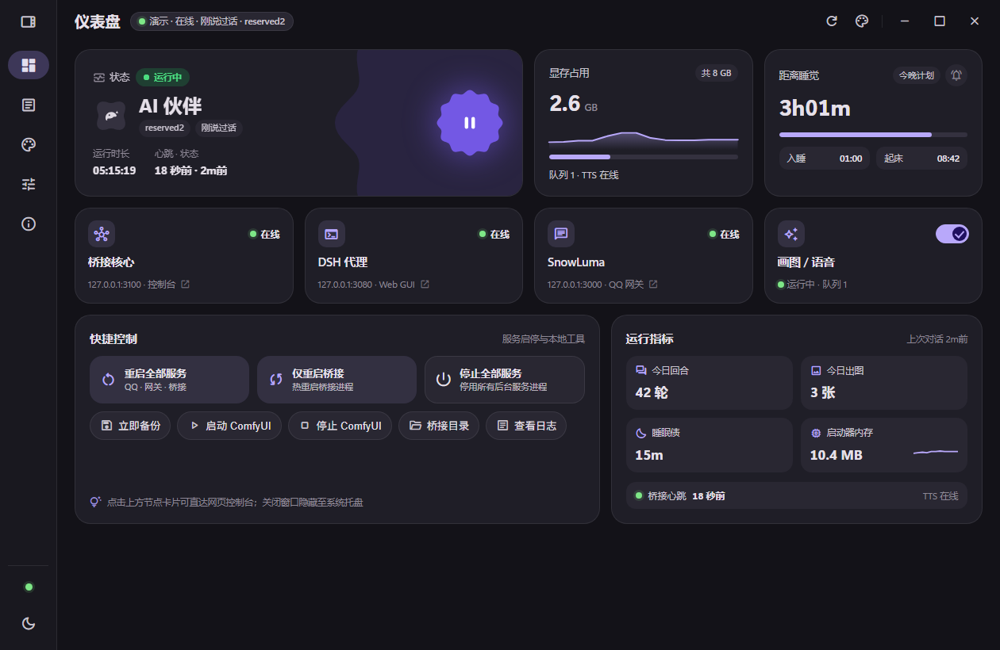
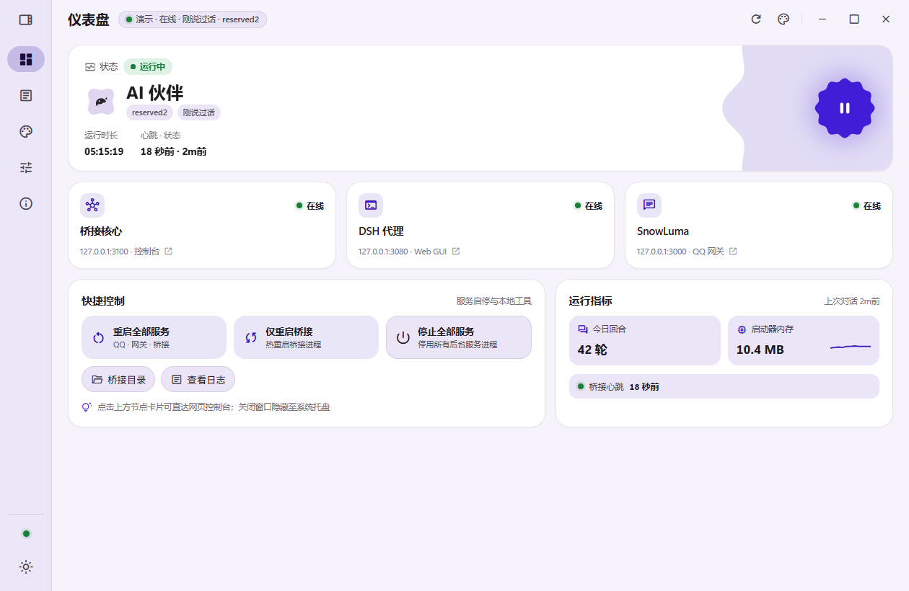
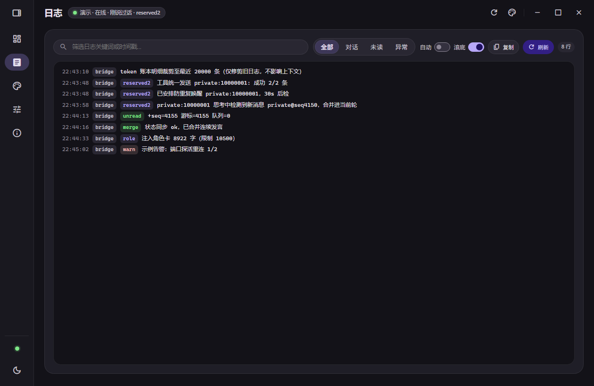
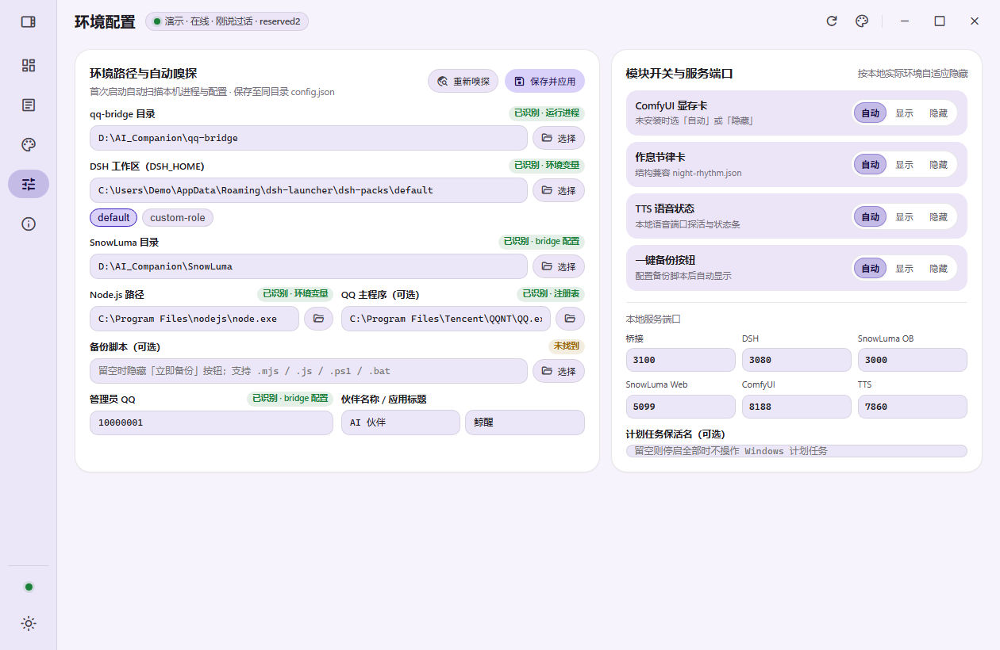

# JingXing Panel（鲸醒面板）

一个给本地运行的 **QQ AI 伙伴**配用的轻量级 Windows 桌面控制面板。

平时在家跑本地 AI 伙伴，往往要开好几个黑框命令行窗口、记一堆端口号、动不动就去翻文件夹改配置、看一行行密密麻麻的纯文本日志。**鲸醒面板**把这些繁琐操作收进了一个干净顺手的桌面窗口里：

- 打开就能**一键启动 / 停止 / 重启**后台服务，平时关掉窗口自动缩到系统托盘安静待着，随时双击回来查看；
- **正在聊没聊、跑了多久、今天出了几张图、还有多久休息**，打开面板一眼看清；
- **装了什么才显示什么**：如果你没装本地画图 / 语音，或者自己改过作息方案，用不到的卡片会自动收起来并重新排好版面，不留空洞。



---

## 用它能做什么

- **一键总控与常驻托盘**：不用同时盯着多个终端黑框，点一下主按钮或快捷按钮就能统一启停服务，也支持单独热重启桥接；窗口关闭默认最小化到右下角托盘图标。
- **装了啥就显啥（自适应排版）**：本地没有配置画图、语音、备份脚本或作息文件时，面板会自动隐藏对应卡片，把剩下的卡片自动拉满对齐。
- **打开自动找齐目录**：启动时会自动扫描你电脑上已经运行或存放的组件目录，填好名字、端口和路径；哪怕放到深层目录或想手动切换，也可以直接在面板里点鼠标「选择」文件夹。
- **能看懂的彩色日志页**：自动把杂乱的纯文本运行日志拆成时间戳和彩色分类胶囊，支持按「全部 / 对话 / 未读 / 异常」过滤和关键词搜索。
- **随时换外观**：内置深色、浅色与纯黑模式，可以自动跟随 Windows 系统主题色，也可以挑选或自定义任意主色调，面板和卡片配色会实时联动变化。

---

## 更多界面预览

**浅色精简模式** —— 当本机未启用画图与作息模块时，多余卡片自动隐藏并保持网格对称：



**日志页** —— 自动提取日志前缀为彩色胶囊标签，长条滚动与关键词筛选更省眼：



**环境配置页** —— 自动探测来源一目了然，可直接点选目录、切换配置包、调整端口与模块显隐：



---

## 怎么开始用

### 1. 运行前准备
- Windows 10 / 11（64 位）
- 安装 [.NET 8 Desktop Runtime (x64)](https://dotnet.microsoft.com/download/dotnet/8.0)（只需装一次）
- Microsoft Edge WebView2 Runtime（Win11 与新版 Win10 通常已自带）

### 2. 下载并启动
1. 前往本仓库 [**Releases**](https://github.com/LT5SS/jingxing-panel/releases) 下载 `JingXingPanel-v1.0.0-win-x64.zip` 解压，或直接下载单文件 `JingXingPanel.exe`。
2. 直接双击打开即可：
   - 如果你原来的机器人后台服务正在运行，面板基本会**全自动识别**完成并保存为同目录下的 `config.json`；
   - 如果有少数路径放在深层目录没自动扫到，或者你想手动隐藏某个模块，切到左侧 **「环境」** 页点「选择」或「重新嗅探」，再点 **「保存并应用」** 就行。

> **只想先看界面效果？** 把下载下来的 `.exe` 文件名里加上 `demo` 或 `演示`（或者命令行加 `--demo` 参数），就会进入**纯演示模式**——不会写入配置文件，也不会动到你正在跑的真实服务。

---

## 技术说明与二次开发

如果你是自己折腾后台或打算基于本面板扩展功能，下面是完整的技术架构与配置细节。

### 适配生态与架构设计
- **适配技术栈**：面向 **`qq-bridge` + `DSH` + `SnowLuma`**，并兼容本地 `ComfyUI`、`TTS` 与作息节律状态。
- **桌面宿主**：`.NET 8 WinForms + WebView2` 单文件桌面应用，支持 WebView2 原生无边框窗口拖拽（`IsNonClientRegionSupportEnabled`）、最大化任务栏避让（`WM_GETMINMAXINFO`）、DWM 标题栏暗亮色联动与单实例唤醒。
- **前端界面**：零外部构建工具链依赖，原生 HTML / CSS / JS 直接内嵌进 `.exe`。采用 Material 3 / Material 3 Expressive 规范，包含 12 瓣极坐标波浪主启停按钮、弹簧导航/分段指示器、View Transition 圆形主题扩散涟漪以及实时动态调色引擎。

### 自动嗅探（`AutoDetector`）与 `config.json`

首次启动无 `config.json` 时，`AutoDetector` 会按优先级探测：
1. 枚举本机运行中的 `node.exe`（`bridge.js` / `mcp-*.js` / `index.mjs` / `@deepseek-ai/dsh --profile --port`）与 `QQ.exe` 命令行及工作目录；
2. 检查环境变量 `DSH_HOME`、`%APPDATA%\dsh-launcher\dsh-packs\*` 与系统注册表中的 QQ 安装路径；
3. 对常见磁盘根目录做浅层扫描兜底；
4. 读取 `<qq-bridge>\config.json` 与 `state\current-role.json`，自动提取端口、管理员 QQ 与伙伴名称。

完整配置字段可参考 [config.example.json](config.example.json)：

```json
{
  "appName": "鲸醒",
  "companionName": "AI 伙伴",
  "bridgeDir": "D:\\YourBot\\qq-bridge",
  "dshHome": "C:\\Users\\You\\AppData\\Roaming\\dsh-launcher\\dsh-packs\\your-pack",
  "snowlumaDir": "D:\\YourBot\\SnowLuma",
  "qqExe": "C:\\Program Files\\Tencent\\QQNT\\QQ.exe",
  "nodeExe": "C:\\Program Files\\nodejs\\node.exe",
  "ownerQQ": "10000001",
  "backupScript": "",
  "guardianTaskName": "",
  "ports": {
    "bridge": 3100,
    "dsh": 3080,
    "snowluma": 3000,
    "snowlumaWeb": 5099,
    "tts": 7860,
    "comfyui": 8188
  },
  "features": {
    "comfyui": "auto",
    "tts": "auto",
    "sleep": "auto",
    "backup": "auto"
  }
}
```

- `features` 取值：`"auto"`（按真实文件配置与端口探活自动决定显隐）、`"show"`（强制显示）、`"hide"`（强制隐藏）。
- 拉起 `qq-bridge` 子进程时会自动注入 `DSH_HOME` 环境变量，避免脱离桌面会话启动找不到 DSH 工作区。
- 命令行运行 `JingXingPanel.exe --sniff-test` 可不弹窗口直接输出脱敏后的环境探测与模块判定 JSON，方便排查环境问题。

### 源码结构与扩展

```text
src/
├── JingXingPanel.csproj   # .NET 8 WinForms 工程与内嵌前端资源声明
├── app.manifest           # PerMonitorV2 DPI 声明
├── Config.cs              # AppConfig 模型 + AutoDetector 本机嗅探器 + ConfigStore
├── Program.cs             # Probe 状态采集 / Actions 进程控制 / WebView2 宿主与 IPC
└── ui/
    ├── index.html         # 5 页 Bento 结构（仪表盘 / 日志 / 外观 / 环境 / 关于）
    ├── md3.css            # Material 3 Expressive 样式与动效
    ├── app.js             # 状态渲染、自适应显隐、动态取色引擎与环境配置页交互
    └── material-symbols-rounded.woff2
```

- **增加自定义状态探测**：在 `src/Program.cs` 的 `Probe.BuildStatus()` 中读取你自己的状态文件或 HTTP 接口，挂载到返回 JSON 的字段。
- **增加前端卡片**：在 `src/ui/index.html` 的 `#page-dash > .bento` 添加 `<article class="card col-4">...</article>`，并在 `src/ui/app.js` 的 `render(s)` 中刷新内容。
- **增加快捷按钮动作**：给按钮加上 `data-act="myAction"`，在 `src/Program.cs` 的 `MainForm.HandleWebMessage` 中对应处理即可。

### 本地编译打包（需 .NET 8 SDK）

```powershell
dotnet publish src\JingXingPanel.csproj -c Release -r win-x64 --self-contained false `
  -p:PublishSingleFile=true -p:IncludeNativeLibrariesForSelfExtract=true -o dist
```

---

## 隐私与安全声明

- 本面板**不写入、不修改**后台对话上下文或记忆文件（仅在用户主动操作时启停进程或调用既有的本地管理接口）。
- 不收集、不上传任何遥测数据，所有状态探活与控制均只在本机 `127.0.0.1` 进行。

## License

[MIT](LICENSE)
